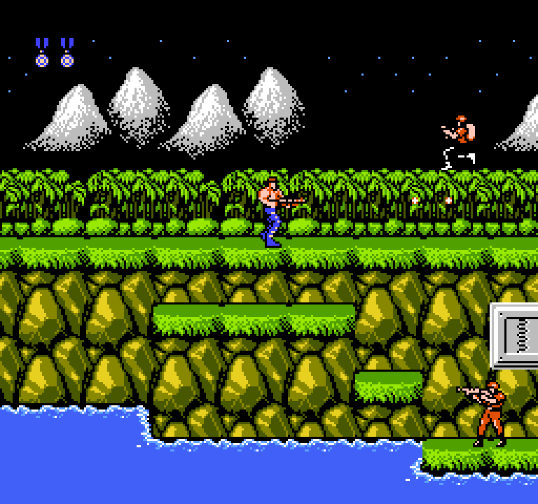

# Contra for Linux (SDL2 and SDL3)

This Linux port uses the game logic and assets from the original Windows project, `feomao/contra_c`. Both the game and its tests are written in C17. Choose SDL2 with SDL2_mixer or SDL3 with native audio streams. No C++ compiler, Windows DLLs, or Wine are required.

## Screenshots

These screenshots were captured from the Linux build.

**Title Screen**


**Stage 1: Jungle**



## Build and Run

The Makefile requires GNU Make, a C17-capable compiler, `pkg-config`, and `unzip`. Install the development packages for the SDL version you want to build:

```sh
sudo apt install gcc libc6-dev make pkg-config unzip libsdl2-dev libsdl2-mixer-dev
```

For SDL3 (3.2.0 or newer), on Debian or Ubuntu releases that package it:

```sh
sudo apt install gcc libc6-dev make pkg-config unzip libsdl3-dev
```

The SDL2 build requires SDL2 2.0.10 or newer and SDL2_mixer 2.0.2 or newer. From the project directory, use `SDL=2` or `SDL=3` to select a build. SDL2 is the default.

```sh
make -j SDL=2
./build-make/contra

make -j SDL=3
./build-make/sdl3/contra
```

Use `make run SDL=2` or `make run SDL=3` to build and launch the selected version in one step. Each executable has a `resource/` directory beside it. You can launch the game from any working directory. If you move the executable, keep its `resource/` directory beside it. Use `--windowed` or `--fullscreen` to override the startup display mode, or `--no-audio` to disable audio.

Alternatively, build with CMake 3.21 or newer. Set `-DSDL=2` for SDL2 or `-DSDL=3` for SDL3:

```sh
cmake -S . -B build -DSDL=3
cmake --build build --parallel
./build/contra
```

## Controls and Configuration

- Arrow keys: move and aim.
- `Z`: shoot; `X`: jump; `A`: rapid fire; `S`: repeat jumps.
- `Enter`: start or pause; `Space`: switch weapons or select a menu item.
- `F11`: toggle fullscreen; `Esc`: quit.

Edit `contra.ini` in the project root, then rebuild with the desired `SDL` value to copy the updated configuration into that build directory. Set `FULLSCREEN=1` to start in fullscreen, set `LIVES` to choose the starting number of lives (1 to 9), or set `BOSSBGM=1` to enable alternate boss music.

## Tests

`make test SDL=2` and `make test SDL=3` use SDL's dummy video and audio drivers to check input, audio, brief gameplay in all eight stages, and the ending sequence. The tests require neither a desktop session nor a sound card, and they do not play through the entire game. Use `make clean SDL=2` or `make clean SDL=3` to remove the selected build's outputs.

For a CMake build, run `ctest --test-dir build --output-on-failure` to run the same checks.

## Project Layout

- `src/`: C source files for the game and SDL platform layer.
- `tests/`: smoke tests.
- `resource/`: graphics, the music archive, and sound effects used by the game.
- `assets/`: README screenshots, not needed to build or run the game.

Before publishing a copy of this project, verify the permissions for redistributing the original code and game assets.
