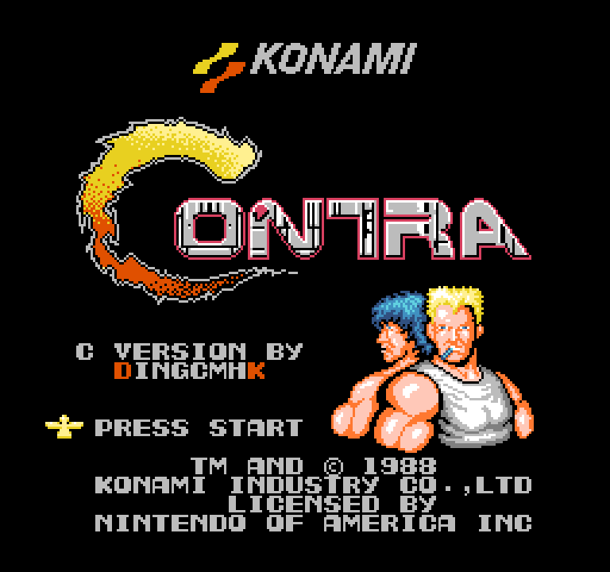

# Contra for Linux (SDL3)

This Linux port uses the game logic and assets from the original Windows project, `feomao/contra_c`. Both the game and its tests are written in C17. SDL3 handles rendering, keyboard input, sound effects, and background music. No C++ compiler, Windows DLLs, or Wine are required.

## Screenshots

These screenshots were captured from the Linux build.

**Title Screen**



**Stage 1: Jungle**


## Build and Run

The Makefile requires GNU Make, a C17-capable compiler, `pkg-config`, `unzip`, and SDL3 development files (3.2.0 or newer). On Debian or Ubuntu releases that package SDL3, install them with:

```sh
sudo apt install gcc libc6-dev make pkg-config unzip libsdl3-dev
```

From the project directory, run:

```sh
make -j
./build-make/contra
```

Use `make run` to build and launch the game in one step. The build copies or extracts the game data into `build-make/resource/`. You can launch the game from any working directory, but if you move the executable, keep its `resource/` directory beside it. Use `--windowed` or `--fullscreen` to override the startup display mode, or `--no-audio` to disable audio.

Alternatively, build with CMake 3.21 or newer:

```sh
cmake -S . -B build
cmake --build build --parallel
./build/contra
```

## Controls and Configuration

- Arrow keys: move and aim.
- `Z`: shoot; `X`: jump; `A`: rapid fire; `S`: repeat jumps.
- `Enter`: start or pause; `Space`: switch weapons or select a menu item.
- `F11`: toggle fullscreen; `Esc`: quit.

Edit `contra.ini` in the project root, then run `make` to copy the updated configuration into the build directory. Set `FULLSCREEN=1` to start in fullscreen, set `LIVES` to choose the starting number of lives (1 to 9), or set `BOSSBGM=1` to enable alternate boss music.

## Tests

`make test` uses SDL's dummy video and audio drivers to check input, audio, brief gameplay in all eight stages, and the ending sequence. The tests require neither a desktop session nor a sound card, and they do not play through the entire game. Use `make clean` to remove the Makefile's build outputs.

For a CMake build, run `ctest --test-dir build --output-on-failure` to run the same checks.

## Project Layout

- `src/`: C source files for the game and SDL3 platform layer.
- `tests/`: smoke tests.
- `resource/`: graphics, the music archive, and sound effects used by the game.
- `assets/`: README screenshots, not needed to build or run the game.

Before publishing a copy of this project, verify the permissions for redistributing the original code and game assets.
